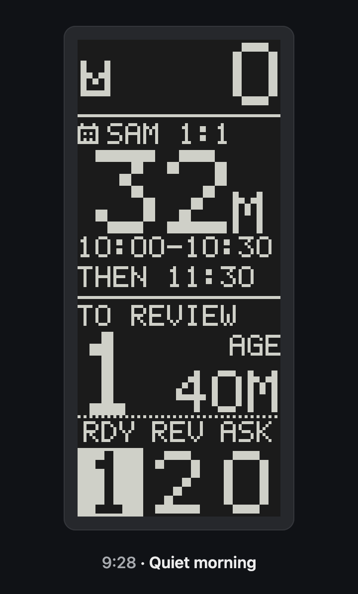
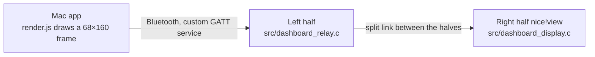

<div align="center">
  
  <h1>keyboard</h1>
  <p><i>A wireless, low-profile Corne that shows what's waiting on me at work</i></p>
</div>

My [ZMK](https://zmk.dev/) config for a [Corne](https://github.com/foostan/crkbd) with nice!nano v2 controllers and nice!view screens. It's my first pocketable build, in a case I modeled and 3D printed, and it should be fairly straightforward to adapt to other setups.

## What it does

### A work dashboard on the right screen

A small Mac app draws the right half's screen and streams it to the keyboard over Bluetooth. At a glance it shows the coding agents waiting on me, my next meeting, and the pull requests I need to review or merge.

<p align="center">
  
  &nbsp;&nbsp;
  
</p>

The screen changes at most once a minute, so it never gets in the way of typing. Changing the layout needs no firmware flash: the Mac app draws every pixel. See [the companion app](#the-companion-app) for how it works.

### Typing

- **Ctrl/Esc:** tap for Esc, hold for Ctrl. It lives in the firmware, so it works on an iPad too.
- **Mouse keys:** move the pointer with Lower+N/M/comma/period, hold Shift to scroll in any direction, and click with the right thumb keys.
- **Headphone modes:** Raise+X and Raise+C switch AirPods or a Sony WH-1000XM5 between noise cancellation and transparency, through Raycast on the Mac.
- **Clipboard history:** Lower+C opens Raycast's clipboard history.
- **Dictation:** a Globe key for Wispr Flow.
- **Media, volume and brightness** on Raise, and **five Bluetooth devices** one keypress apart.

The full layout and every key are in [docs/layout.md](docs/layout.md).

## Build and flash

GitHub Actions builds three files on every push: `corne_left`, `corne_right` (with the dashboard display), and `settings_reset`. Download them from the run's artifacts. Pushes to `main` also publish them as a release.

To flash a half, connect it by USB-C, double-tap its reset button, and copy its `.uf2` onto the `NICENANO` drive that appears. The drive disappears when it's done.

- **Keymap changes:** flash only the left half; ZMK runs the keymap there.
- **Right-screen firmware changes:** flash the right half.
- **First install, or changes to how the halves talk:** flash both.

Without the Mac app, the right screen shows "NO DATA" and the keyboard works normally.

## Mac setup

Raycast hotkeys handle the F-keys, so Karabiner-Elements is not needed.

1. Build the headphones helper and link its Raycast script commands into a Raycast script directory (here `~/.config/raycast/scripts`):

   ```sh
   swiftc -O macos/headphones-mode.swift -o ~/.local/bin/headphones-mode
   ln -s "$PWD"/macos/raycast/*.sh ~/.config/raycast/scripts/
   ```

2. In Raycast Settings → Extensions, record these hotkeys by pressing the Corne keys:

   | Raycast command | Corne keys | Key sent |
   | --- | --- | --- |
   | Clipboard History | Lower+C | `F18` |
   | Headphones Noise Cancellation | Raise+X | `F19` |
   | Headphones Transparency | Raise+C | `F20` |

3. Turn off macOS mouse-wheel acceleration, which otherwise makes a held scroll key start slowly and then race. This applies to every mouse:

   ```sh
   defaults write -g com.apple.scrollwheel.scaling -float -1
   ```

4. Optionally, install [the companion app](#the-companion-app) for the right screen.

`headphones-mode` switches every connected supported headphone at once. For AirPods and Beats it sets the listening mode through an undocumented Core Audio property, as found by [pods-control](https://github.com/raulgg/pods-control). For the Sony WH-1000XM5 it sends Sony's own control command, as reverse-engineered by [SonyHeadphonesClient](https://github.com/Plutoberth/SonyHeadphonesClient); Raycast needs Bluetooth permission for this. Both paths are undocumented, so a macOS or headphone update could break them.

## The companion app

`macos/dashboard/` holds `corne-dashboard`, a background app (LaunchAgent) that draws the right screen once a minute and sends only what changed. The left half is the only half connected to the Mac, so it relays the screen to the right half:



It reads:

- **Agents:** windows in the `tmux` session `work`. An agent marks its window with `@agent_state` set to `ask` or `error`; a window that rang the bell counts as finished.
- **Meetings:** the macOS calendar (EventKit), next three days. A meeting is an event with a video link or another attendee. ON AIR follows the microphone, so it works for unscheduled calls too.
- **Pull requests:** `gh`, for `TeracAI/platform`. To review: PRs that request my review personally, not through a team. Mine: ready (approved and mergeable), in review (a person asked or reviewed), and nobody asked yet (only team requests or bot reviews). Drafts don't count.

Install or update it (it needs `gh` logged in):

```sh
macos/dashboard/install.sh
```

The first run asks for Calendar and Bluetooth access. The log is `~/Library/Logs/corne-dashboard.log`. `corne-dashboard --print-state` prints the data it would draw, and `corne-dashboard --snapshot screen.png` writes the screen as an image; neither touches Bluetooth.

To turn it off, run `launchctl bootout gui/$(id -u)/dev.brainsaysno.corne-dashboard`. The right screen shows "NO DATA" two minutes later.

Only a device paired with the keyboard can write to the screen, because both halves require an encrypted connection. The keyboard treats what it receives as pixels only; it can't type or change the keymap.

`macos/dashboard/render.js` is the only definition of the layout and wording, so changing it needs no firmware flash: rerun `install.sh`, which compiles it into the app. Open `macos/dashboard/preview.html` through a local web server to see every state. The keyboard draws one screen itself, the "NO DATA" screen (`src/dashboard_stale.c`), so it can appear when the Mac is silent.

To adapt it:

| What | Where |
| --- | --- |
| GitHub repository | `requestedSearch` and `mineSearch` in `macos/dashboard/Logic.swift` |
| Video call links | `videoCallHosts` in `macos/dashboard/Logic.swift` |
| tmux session | `collectWaiting` in `macos/dashboard/Collectors.swift` |
| Your name (for 1:1 titles) and meeting-title shortcuts | `ME` and `ALIASES` in `macos/dashboard/render.js` |

## Troubleshooting

- **The Mac shows the Corne stuck "connecting":** macOS's Bluetooth LE process can hold stale state. Run `sudo killall -9 BTLEServer` (macOS restarts it), then reconnect.
- **A screen looks garbled after flashing:** the half is still in its bootloader, which doesn't drive the screen, because the copy was cut short. Double-tap reset and copy the file again, with a different cable or port if it keeps failing.
- **The right screen says "NO DATA" or "WAITING FOR MAC APP":** the companion app isn't running or can't reach the keyboard. Check its log. "No connected keyboard offers the dashboard service" means the left half is disconnected or doesn't have the dashboard firmware.

## Development

Run `python3 -m unittest discover -s tests -v` to check the keymap, the Shift-scroll helper, the "NO DATA" screen against render.js, and the companion app's pull request, meeting, and frame-diff logic. The tests need a C compiler, `swiftc`, and `node`. They don't replace a firmware build or trying it on the keyboard.

Feel free to use or adapt any of this for your own build.
