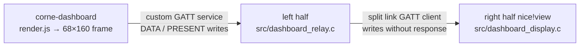

<div id="top"></div>

<div align="center">

[![Contributors][contributors-shield]][contributors-url]
[![Forks][forks-shield]][forks-url]
[![Stargazers][stars-shield]][stars-url]
[![Issues][issues-shield]][issues-url]

</div>

<br />
<div align="center">
  <a href="https://github.com/brainsaysno/keyboard">
    
  </a>
  <br/>
  <i> zmk config for my wireless, low profile corne build with nice!nano v2s and nice!view displays </i>
  <br/>
  <br/>

<h1 align="center">keyboard</h1>
  <p align="center">
    <a href="https://github.com/brainsaysno/keyboard"><strong>Explore docs »</strong></a>
    <br />
    <br />
    <a href="https://github.com/brainsaysno/keyboard/issues/new?labels=enhancement">Suggest a feature</a>
    ·
    <a href="https://github.com/brainsaysno/keyboard/issues/new?labels=bug">Report a bug</a>
  </p>
</div>

<details>
  <summary>Table of Contents</summary>
  <ol>
    <li>
      <a href="#about-the-project">About the Project</a>
      <ul>
        <li><a href="#cool-tweaks">Cool Tweaks</a></li>
      </ul>
    </li>
    <li><a href="#layout">Layout</a></li>
    <li><a href="#usage">Usage</a></li>
  </ol>
</details>

## About the Project

My [zmk](https://zmk.dev/) config for my wireless, low profile [corne](https://github.com/foostan/crkbd) build using nice!nano v2s and nice!view displays. It's part of my first pocketable build. Should be fairly straightforward to adapt to other setups. I also modeled and 3D printed a case for it.

### Cool Tweaks

- **Ctrl/Esc combo:** Hold for ctrl, tap for escape. This is my most used keymap by far, and it's nice to have it in the firmware so it works in iOS as well
- **Mouse emulation:** Move cursor and right/left click from lower layer; Shift with mouse up/down scrolls
- **Clipboard history:** Lower+C sends F18, bound in Raycast to Clipboard History
- **Globe key:** For dictation with Wispr Flow
- **Media and brightness controls:** On raise layer
- **Bluetooth profiles:** Quick switching across 5 devices
- **Work dashboard:** The right half's nice!view shows what's waiting on me: agent windows in tmux, the next meeting (or ON AIR while my mic is live), PRs to review, and my own PRs. A Mac app renders it and streams it to the keyboard

## Layout

3x6 Corne split.

- **Base:** QWERTY-ish
- **Lower:** Numbers, arrow keys (vim hjkl), mouse movement/scrolling, clipboard history, direct Bluetooth profile selection
- **Raise:** Symbols, media, headphone listening modes, brightness controls
- **Adjust:** Bluetooth setup. Hold both Lower and Raise to activate it; release either to leave it.

### Audio and headphone keys

Hold the right-thumb Raise key and press the physical key listed below:

| Key | Action | Keycode |
| --- | --- | --- |
| Z | Output mute | `C_MUTE` |
| X | Headphones noise cancellation | `F19` |
| C | Headphones transparency | `F20` |
| V | Brightness down | `C_BRI_DN` |
| B | Brightness up | `C_BRI_UP` |

The existing media controls on Raise+A/S/D/F/G are unchanged.

The firmware only sends `F19` and `F20`; Raycast hotkeys turn them into listening-mode changes. See [Mac setup](#mac-setup).

### Bluetooth setup

Hold both layer thumb keys to access Adjust:

- A/S/D/F/G select Bluetooth profiles 1 through 5, matching the existing Lower shortcuts.
- Z selects the previous profile; C selects the next profile.
- X clears the selected keyboard profile's pairing. Use it only when re-pairing, not to disconnect a device.

Other Adjust keys are disabled to prevent media or typing actions from falling through. Lower+A/S/D/F/G remain available for quick device switching without holding both thumbs.

### Clipboard history and scrolling

| Binding | Action |
| --- | --- |
| Lower+C | Send `F18` for Raycast Clipboard History |
| Lower+M | Move mouse down |
| Lower+comma | Move mouse up |
| Lower+Shift+M | Scroll down |
| Lower+Shift+comma | Scroll up |

Hold Shift before pressing the mouse key. To switch between moving and scrolling, release the mouse key, change Shift, and press it again. Left/right mouse movement and the H/J/K/L arrow keys are unchanged, including Shift+arrows for selecting text. The wheel directions are inverted so the page moves the way the key points with macOS natural scrolling on; with natural scrolling off, they are reversed.

The local `zmk,behavior-shift-scroll` behavior sends a keyboard modifier report before scrolling. Stock ZMK v0.3 mod-morph masks modifiers internally but does not itself send that report, and a mouse behavior does not send one either. The helper suppresses Shift during scrolling and restores it when the last scrolling key is released, preventing the host from interpreting vertical wheel events as Shift-scroll.

### Mac setup

Raycast hotkeys handle the F-keys, so Karabiner-Elements is not needed. Karabiner leaves the Corne alone by default because it is both a keyboard and a pointing device.

1. Build the headphones helper and link its Raycast script commands into a Raycast script directory (here `~/.config/raycast/scripts`):

   ```sh
   swiftc -O macos/headphones-mode.swift -o ~/.local/bin/headphones-mode
   ln -s "$PWD"/macos/raycast/*.sh ~/.config/raycast/scripts/
   ```

2. In Raycast Settings → Extensions, record these hotkeys by pressing the Corne keys:

   | Raycast command | Corne keys | Key sent |
   | --- | --- | --- |
   | Clipboard History | Lower+C | `F18` |
   | Headphones Noise Cancellation | Raise+X | `F19` |
   | Headphones Transparency | Raise+C | `F20` |

3. Turn off macOS mouse-wheel acceleration, which otherwise makes a held scroll key start slowly and then race. This applies to every mouse:

   ```sh
   defaults write -g com.apple.scrollwheel.scaling -float -1
   ```

`headphones-mode` switches every connected supported headphone at once:

- **AirPods and Beats:** writes the listening mode to the headphones' Core Audio device through its undocumented `lstm` property, as found by [pods-control](https://github.com/raulgg/pods-control). Needs no permissions and shows no UI.
- **Sony WH-1000XM5:** sends Sony's own control command over the Bluetooth channel the headphones publish for their phone app, as reverse-engineered by [SonyHeadphonesClient](https://github.com/Plutoberth/SonyHeadphonesClient). Transparency maps to Ambient Sound, keeping the current ambient level and voice focus. Other Sony models that use a different noise-control layout are reported as unsupported. Raycast needs Bluetooth permission for this.

Both paths are undocumented, so a macOS or headphone firmware update could break them.

### Work dashboard

`macos/dashboard/` holds `corne-dashboard`, a LaunchAgent that redraws the right half's screen once a minute, sending only what changed. Every refresh briefly takes the keyboard's radio away from typing, so the screen shows minutes, never seconds. It streams the screen through the left half, which is the only half connected to the Mac:



- **Top strip:** how many `tmux` windows in session `work` are waiting on me (an agent asked a question or hit an error, or a window rang the bell). It inverts while an agent is asking or stuck.
- **Meeting band:** the next calendar event with a video link or another attendee (EventKit, next three days): a countdown for today, the weekday for later. Two minutes before it starts the band inverts. While any microphone is live it shows ON AIR with the minutes elapsed.
- **TO REVIEW:** open `TeracAI/platform` PRs that request my review personally (team requests don't count), with the oldest request's age.
- **MY PRS:** my open, non-draft `TeracAI/platform` PRs in three large counts. RDY is approved and mergeable, REV has a person asked or a person's review, and ASK has only team requests or bot reviews. RDY and ASK invert when above zero.

`macos/dashboard/render.js` is the only definition of the layout and copy, so a layout change needs no firmware flash. Open `macos/dashboard/preview.html` through a local web server to see every state. The keyboard draws one screen itself: after two minutes without a frame, or before the first one, it shows "NO DATA" (`src/dashboard_stale.c`).

Install or update the app (it needs `gh` logged in with access to `TeracAI/platform`). render.js is compiled into the binary, so rerun this after changing it:

```sh
macos/dashboard/install.sh
```

The first run asks for Calendar and Bluetooth access. The log is `~/Library/Logs/corne-dashboard.log`. `corne-dashboard --print-state` prints the data it would draw, and `corne-dashboard --snapshot screen.png` writes the screen as an image; neither touches Bluetooth.

### Local validation

Run `python3 -m unittest discover -s tests -v` to check the keymap, the Shift-scroll helper's modifier and release behavior, the dashboard's "no data" screen against render.js, and the Mac app's PR, meeting, and frame-diff logic. The C and Swift tests need a host C compiler, `swiftc`, and `node`. This is not a replacement for a full ZMK firmware build or on-device testing.

## Usage

There's a github action which handles the build. Flash it and you're good to go.

Feel free to use or adapt any of this for your own build.

[contributors-shield]: https://img.shields.io/github/contributors/brainsaysno/keyboard.svg?style=for-the-badge
[contributors-url]: https://github.com/brainsaysno/keyboard/graphs/contributors
[forks-shield]: https://img.shields.io/github/forks/brainsaysno/keyboard.svg?style=for-the-badge
[forks-url]: https://github.com/brainsaysno/keyboard/network/members
[stars-shield]: https://img.shields.io/github/stars/brainsaysno/keyboard.svg?style=for-the-badge
[stars-url]: https://github.com/brainsaysno/keyboard/stargazers
[issues-shield]: https://img.shields.io/github/issues/brainsaysno/keyboard.svg?style=for-the-badge
[issues-url]: https://github.com/brainsaysno/keyboard/issues
