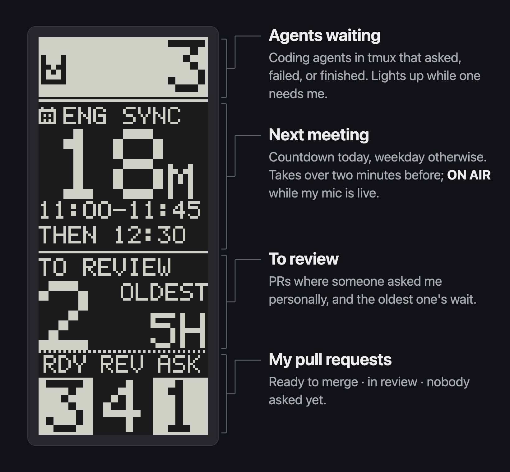

<div align="center">
  
  <h1>keyboard</h1>
</div>

My [ZMK](https://zmk.dev/) config for a [Corne](https://github.com/foostan/crkbd) with nice!nano v2 controllers and nice!view screens. It's my first pocketable build, in a case I modeled and 3D printed, and it should be fairly straightforward to adapt to other setups.

## Right screen

A small Mac app, [corne-companion](docs/companion.md), draws the right half's screen and sends it to the keyboard over Bluetooth. It shows the coding agents waiting on me, my next meeting, and the pull requests I need to review or merge.

<p align="center">
  
  &nbsp;&nbsp;
  
</p>

It updates at most once a minute, so it never gets in the way of typing, and changing what it shows needs no firmware flash.

## Keys

- **Ctrl/Esc:** tap for Esc, hold for Ctrl. It lives in the firmware, so it works on an iPad too.
- **Mouse keys:** move the pointer with Lower+N/M/comma/period, hold Shift to scroll in any direction, and click with the right thumb keys.
- **Headphone modes:** Raise+X and Raise+C switch AirPods or a Sony WH-1000XM5 between noise cancellation and transparency, through the companion app.
- **Clipboard history:** Lower+C sends `F18`, which a Raycast hotkey turns into Raycast's clipboard history.
- **Dictation:** a Globe key for Wispr Flow.
- **Media, volume and brightness** on Raise, and **five Bluetooth devices** one keypress apart.

The full layout and every key are in [docs/layout.md](docs/layout.md).

## Build and flash

GitHub Actions builds three files on every push: `corne_left`, `corne_right` (with the dashboard display), and `settings_reset`. Download them from the run's artifacts. Pushes to `main` also publish them as a release.

To flash a half, connect it by USB-C, double-tap its reset button, and copy its `.uf2` onto the `NICENANO` drive that appears. The drive disappears when it's done.

- **Keymap changes:** flash only the left half; ZMK runs the keymap there.
- **Right-screen firmware changes:** flash the right half.
- **First install, or changes to how the halves talk:** flash both.

Without the companion app, the right screen shows "NO DATA" and the keyboard works normally.

## Mac setup

1. Install the companion app, which draws the right screen and handles the headphone keys. It needs `gh` logged in:

   ```sh
   macos/companion/install.sh
   ```

   Then set your GitHub repository in `~/.config/corne-companion/config.json` and run it again. See [docs/companion.md](docs/companion.md) for the details.

2. In Raycast Settings → Extensions → Clipboard History, record the hotkey by pressing Lower+C, which sends `F18`.

3. Turn off macOS mouse-wheel acceleration, which otherwise makes a held scroll key start slowly and then race. This applies to every mouse:

   ```sh
   defaults write -g com.apple.scrollwheel.scaling -float -1
   ```

## Troubleshooting

- **The Mac shows the Corne stuck "connecting":** macOS's Bluetooth LE process can hold stale state. Run `sudo killall -9 BTLEServer` (macOS restarts it), then reconnect.
- **A screen looks garbled after flashing:** the half is still in its bootloader, which doesn't drive the screen, because the copy was cut short. Double-tap reset and copy the file again, with a different cable or port if it keeps failing.
- **The right screen or the headphone keys:** see [the companion app's troubleshooting](docs/companion.md#troubleshooting).

## Development

Run `python3 -m unittest discover -s tests -v` to check the keymap, the Shift-scroll helper, the "NO DATA" screen against render.js, and the companion app's pull request, meeting, and frame-diff logic. The tests need a C compiler, `swiftc`, and `node`. They don't replace a firmware build or trying it on the keyboard.

Feel free to use or adapt any of this for your own build.
