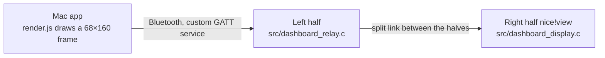

# corne-companion

A background Mac app (a LaunchAgent) that draws the keyboard's right screen and handles the headphone keys. The code is in [`macos/companion/`](../macos/companion). Back to the [README](../README.md).

## How it works

Once a minute the app draws the right screen with `render.js` and sends only the bytes that changed. The left half is the only half connected to the Mac, so it relays the screen to the right half:



The screen changes at most once a minute because every update briefly takes the keyboard's radio away from typing.

## What it reads

- **Agents:** windows in the `tmux` session `work`. An agent marks its window with `@agent_state` set to `ask` or `error`; a window that rang the bell counts as finished.
- **Meetings:** the macOS calendar (EventKit), next three days. A meeting is an event with a video link or another attendee. ON AIR follows the microphone, so it works for unscheduled calls too.
- **Pull requests:** `gh`, for the repository set in the config. To review: PRs that request my review personally, not through a team. Mine: ready (approved and mergeable), in review (a person asked or reviewed), and nobody asked yet (only team requests or bot reviews). Drafts don't count.

## Headphone keys

Raise+X sends `F19` (noise cancellation) and Raise+C sends `F20` (transparency). The app catches them as global hotkeys, which need no Accessibility permission, and switches every connected AirPods, Beats or Sony WH-1000XM5 at once.

- **AirPods and Beats** take the mode through an undocumented Core Audio property, as found by [pods-control](https://github.com/raulgg/pods-control).
- **The Sony** gets Sony's own control command, as reverse-engineered by [SonyHeadphonesClient](https://github.com/Plutoberth/SonyHeadphonesClient).

Both paths are undocumented, so a macOS or headphone update could break them. `corne-companion --headphones transparency` (or `noise-cancellation`) does the same by hand.

## Install

It needs `gh` logged in.

```sh
macos/companion/install.sh
```

The first run creates `~/.config/corne-companion/config.json` from [`config.example.json`](../macos/companion/config.example.json). Set `githubRepo` there and run `install.sh` again. It also asks for Calendar and Bluetooth access.

Rerun `install.sh` after changing any of the app's code, including `render.js`, which is compiled into the app.

## Settings

| What | Where |
| --- | --- |
| GitHub repository | `githubRepo` in `~/.config/corne-companion/config.json` |
| Video call links | `videoCallHosts` in `macos/companion/Logic.swift` |
| tmux session | `collectWaiting` in `macos/companion/Collectors.swift` |
| Your name (for 1:1 titles) and meeting-title shortcuts | `ME` and `ALIASES` in `macos/companion/render.js` |

The app reads the config when it starts, so restart it after editing:

```sh
launchctl kickstart -k gui/$(id -u)/dev.brainsaysno.corne-companion
```

## Changing the screen

`macos/companion/render.js` is the only definition of the layout and wording, so changing it needs no firmware flash. Open `macos/companion/preview.html` through a local web server to see every state.

The keyboard draws one screen itself, "NO DATA" (`src/dashboard_stale.c`), so it can show when the Mac is silent.

## Checking what it does

- The log is `~/Library/Logs/corne-companion.log`.
- `corne-companion --print-state` prints the data it would draw.
- `corne-companion --snapshot screen.png` writes the screen as an image.

Neither command touches Bluetooth.

## Turning it off

```sh
launchctl bootout gui/$(id -u)/dev.brainsaysno.corne-companion
```

The right screen shows "NO DATA" two minutes later.

## Privacy

Only a device paired with the keyboard can write to the screen, because both halves require an encrypted connection. The keyboard treats what it receives as pixels only; it can't type or change the keymap.

## Troubleshooting

- **The right screen says "NO DATA" or "WAITING FOR MAC APP":** the app isn't running or can't reach the keyboard. Check the log. "No connected keyboard offers the dashboard service" means the left half is disconnected or doesn't have the dashboard firmware.
- **The headphone keys do nothing:** another app owns `F19` or `F20`, and the log says "could not register". Remove that app's hotkey (for example an old Raycast one) and restart the app.
