# Layout

Every layer of the 42-key Corne keymap in [`config/corne.keymap`](../config/corne.keymap). Back to the [README](../README.md).



Highlighted keys are held to reach the layer. ▽ keys act as they do on Base, and blank keys on Adjust do nothing.

The drawing is made with [keymap-drawer](https://github.com/caksoylar/keymap-drawer), using the settings in [`keymap-drawer.yaml`](keymap-drawer.yaml). After changing the keymap, redraw it from the repo root (needs [uv](https://docs.astral.sh/uv/)):

```sh
uvx --from keymap-drawer==0.23.0 keymap -c docs/keymap-drawer.yaml parse -z config/corne.keymap -l Base Lower Raise Adjust \
  | uvx --from keymap-drawer==0.23.0 keymap -c docs/keymap-drawer.yaml draw - -o docs/images/keymap.svg
```

## Audio and headphone keys

Hold Raise (right thumb) and press:

| Key | Action | Keycode |
| --- | --- | --- |
| Z | Output mute | `C_MUTE` |
| X | Headphones noise cancellation | `F19` |
| C | Headphones transparency | `F20` |
| V | Brightness down | `C_BRI_DN` |
| B | Brightness up | `C_BRI_UP` |

Raise+A/S/D/F/G are the media keys: previous track, play/pause, next track, volume down and volume up.

The firmware only sends `F19` and `F20`. The [companion app](../README.md#the-companion-app) turns them into listening-mode changes.

## Bluetooth setup

Hold Lower and Raise together to reach Adjust. Release either one to leave it.

- A/S/D/F/G select Bluetooth profiles 1 to 5, the same as Lower+A/S/D/F/G.
- Z selects the previous profile and C the next one.
- X clears the selected keyboard profile's pairing. Use it only to re-pair a device, not to disconnect one.

All other Adjust keys are disabled, so media or typing actions can't fall through. Lower+A/S/D/F/G still switch devices without holding both thumbs.

## Clipboard history and scrolling

| Binding | Action |
| --- | --- |
| Lower+C | Send `F18` for Raycast Clipboard History |
| Lower+N / M / comma / period | Move mouse left / down / up / right |
| Lower+Shift+N | Scroll left |
| Lower+Shift+M | Scroll down |
| Lower+Shift+comma | Scroll up |
| Lower+Shift+period | Scroll right |

Hold Shift before pressing the mouse key. To switch between moving and scrolling, release the mouse key, change Shift, and press it again. Shift with the H/J/K/L arrow keys still selects text. The wheel directions are inverted on both axes, so with macOS natural scrolling on, the page moves the way the key points; with natural scrolling off, it moves the other way.

The scrolling keys use the local `zmk,behavior-shift-scroll` behavior, which sends a keyboard modifier report before scrolling. Stock ZMK v0.3 mod-morph masks modifiers internally but does not send that report, and a mouse behavior does not send one either. The helper suppresses Shift while scrolling and restores it when the last scrolling key is released, so the host does not treat the wheel events, vertical or horizontal, as Shift-scroll.
